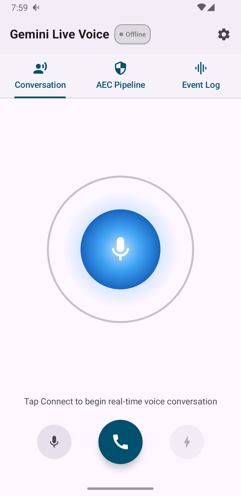
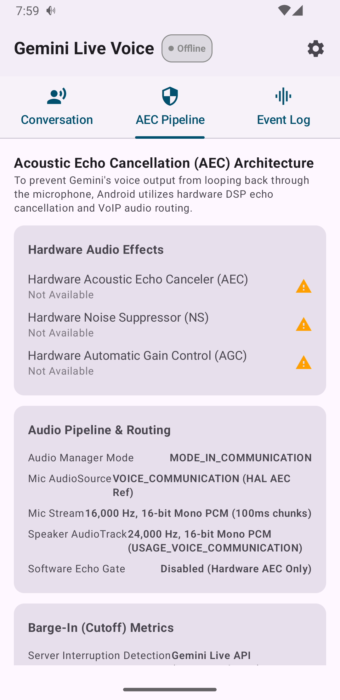
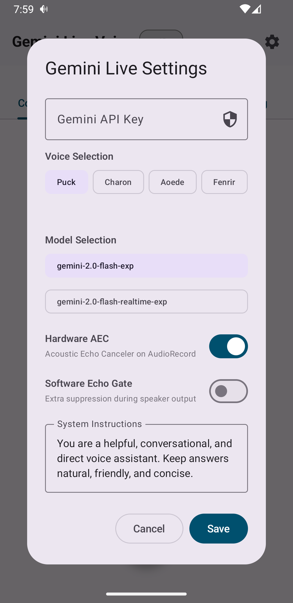

# Gemini Live Voice Assistant (Android Native)

A production-ready Android native application built with **Kotlin** and **Jetpack Compose** that interacts in real-time with the **Gemini Multimodal Live API (`BidiGenerateContent`)** over WebSockets, featuring **Barge-In (interruption)** and **Hardware Acoustic Echo Cancellation (AEC)**.

Package ID: `id.bukuanak.geminilive`

---

## Key Features

1. **Gemini Multimodal Live API (`BidiGenerateContent`)**
   - Direct, low-latency bidirectional WebSocket communication via OkHttp.
   - Streams 16 kHz 16-bit mono linear PCM microphone audio upstream.
   - Receives and plays 24 kHz 16-bit mono linear PCM audio response downstream.
   - Configurable voice selection (`Puck`, `Charon`, `Aoede`, `Fenrir`, `Kore`), models, and custom system instructions.

2. **Acoustic Echo Cancellation (AEC)**
   - Configures `AudioManager.mode = AudioManager.MODE_IN_COMMUNICATION` with `AudioDeviceInfo.TYPE_BUILTIN_SPEAKER` (API 31+).
   - `AudioRecord` uses `MediaRecorder.AudioSource.VOICE_COMMUNICATION` to engage hardware DSP echo cancellation.
   - Attaches hardware `AcousticEchoCanceler`, `NoiseSuppressor`, and `AutomaticGainControl` directly to the audio session ID.
   - `AudioTrack` runs with `USAGE_VOICE_COMMUNICATION` and `CONTENT_TYPE_SPEECH` to provide the exact reference playback signal for DSP cancellation.
   - Includes an optional **Software Echo Gate** for devices or emulators lacking native OEM hardware AEC drivers.

3. **Barge-In (Interruption Cutoff)**
   - Real-time server-side interruption detection (`serverContent.interrupted = true`).
   - Client immediately drops pending audio packets, calls `AudioTrack.pause()`, `AudioTrack.flush()`, and restarts playback with **< 10ms cutoff latency**.
   - Manual barge-in action button for testing or instant silencing.

4. **Modern UI & Inspection Tools**
   - **Dual Voice Orb**: Real-time animated waveforms reacting to user mic RMS and Gemini speaker RMS.
   - **AEC Pipeline Tab**: Live diagnostics displaying hardware AEC/NS/AGC availability, audio modes, and buffer specs.
   - **Event Log Tab**: Stream inspection displaying raw WebSocket events, chunk transfers, and interruption metrics.
   - **Settings Dialog**: In-app Gemini API Key configuration, voice selector, and model selector.

---

## Screenshots

| Main Conversation | AEC Pipeline Diagnostics | Settings Dialog |
| :---: | :---: | :---: |
|  |  |  |

---

## Project Structure

```
app/src/main/kotlin/id/bukuanak/geminilive/
├── MainActivity.kt
├── Navigation.kt
├── audio/
│   ├── AudioConfig.kt               # 16kHz input / 24kHz output PCM definitions
│   ├── AudioRecorder.kt            # VOICE_COMMUNICATION mic capture & RMS metering
│   ├── AudioTrackPlayer.kt         # Low-latency streaming player with instant flush
│   └── EchoCancellationManager.kt  # Hardware AcousticEchoCanceler & communication routing
├── live/
│   ├── GeminiLiveClient.kt         # OkHttp WebSocket client & Bidi protocol handler
│   └── LiveClientModels.kt         # Kotlinx serialization data contracts
├── data/
│   └── AppSettings.kt              # API key, voice, and audio preference persistence
└── ui/main/
    ├── LiveVoiceViewModel.kt       # Live state orchestrator & event bus
    └── LiveVoiceScreen.kt          # Compose UI with dual visualizer, AEC tab & settings
```

---

## Getting Started

### Prerequisites
- Android Studio Ladybug / Meerkat or Android SDK (compileSdk 36, minSdk 26).
- JDK 17 or higher.
- Gemini API Key from [Google AI Studio](https://aistudio.google.com/).

### Building & Running
```bash
# Clone the repository
git clone https://github.com/hakimrie/gemini-live.git
cd gemini-live

# Run unit tests
./gradlew test

# Build and install on connected device / emulator
./gradlew installDebug
```

1. Launch **Gemini Live Voice** on your device.
2. Tap the **Settings** icon (top right) and enter your Gemini API Key.
3. Tap the green **Connect** button, grant the audio permission, and start speaking!
